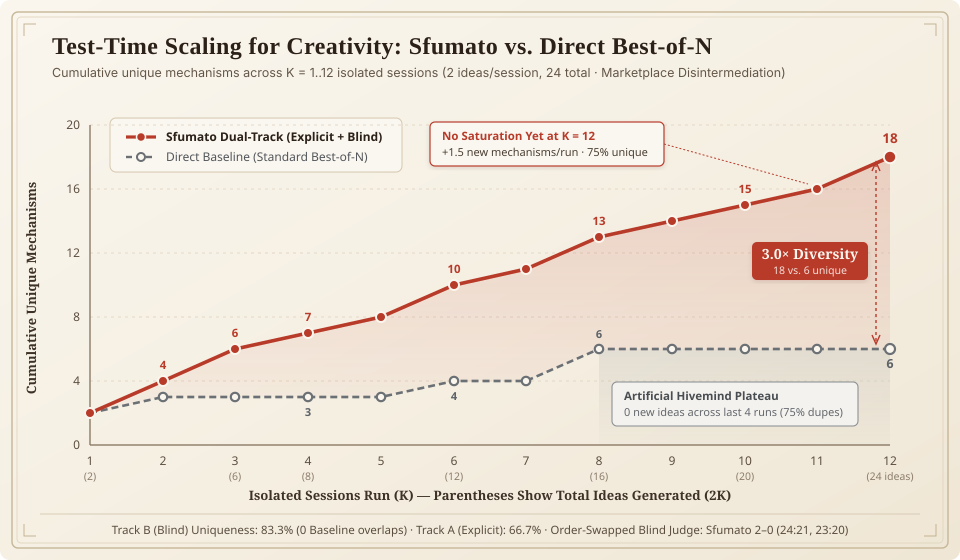
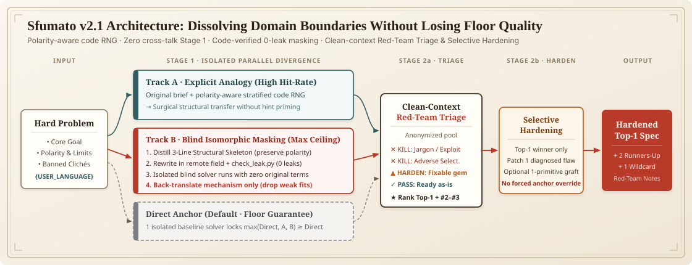

<div align="center">

<p align="center">
  
  &nbsp;&nbsp;
  
  &nbsp;&nbsp;
  
</p>

# 🎨 Sfumato (스푸마토)

### *도메인의 경계를 지워 AI 동질화(Artificial Hivemind)를 깨는 초경량 창의성 플러그인*

<p>
  <a href="./README.md">English</a> · <a href="./README.ko.md"><strong>한국어</strong></a>
</p>

<p>
  
  
  
  
  
</p>

<sub><strong>Excelsus4</strong> with <strong>Gemini 4 Neon</strong> · 모든 K=1..12 스케일링 실험은 Gemini 4 Neon (High) 기준으로 측정되었습니다.</sub>

> *'스푸마토(Sfumato, 연기처럼 경계를 흐린다)'는 레오나르도 다빈치가 딱딱한 윤곽선을 지워 전혀 새로운 형상을 끌어낸 회화 기법입니다. 다빈치는 한 분야에 갇히지 않고 해부학·유체역학·축성술·광학의 원리를 서로 이식해 천재적 발명을 만들어냈습니다.*
>
> **Sfumato**는 외부 RAG도, 파인튜닝도, 외부 라이브러리도 없이 **단 4개 파일(`/sfumato`, `/sfm`)**만으로 AI 에이전트의 창의력 최고점(Top-1)을 끌어올립니다.

</div>

---

## 🔥 문제의식: 왜 LLM은 아무리 다시 물어도 똑같은 아이디어만 낼까?

코딩이나 추론에서는 **관련 있는 깨끗한 컨텍스트**만 넣는 게 정배입니다. 무관한 정보는 Attention을 분산시키는 버그니까요.

**하지만 브레인스토밍에서는 정반대 현상이 벌어집니다.**

아무리 새로운 격리 세션에서 12번을 반복해 물어도, LLM은 통계적으로 가장 무난한 3~6개의 교과서 클리셰로 수렴합니다(*Artificial Hivemind*, NeurIPS). `temperature`를 높이면 독창적이 되기 전에 논리가 먼저 무너지고, 멀티에이전트 토론을 붙이면 오히려 합의 편향으로 다양성이 더 쪼그라듭니다(*Diversity Collapse*).

> **🧪 실제 파일럿에서 포착된 스모킹 건 (`OSS-PR`):**
> *"오픈소스 저장소의 AI 슬롭 PR 홍수를 막는 법"*을 물었을 때, 서로 완전히 격리된 **3개 세션**(`Direct Baseline 1`, `Direct Baseline 2`, 심지어 `열역학 Explicit`까지)이 **독립적으로 똑같은 임의 PR 번호 `pkg@pr-4821` / `pkg@patch-4821`을 생성**했습니다.
>
> 반면 Sfumato의 **Blind 동형 마스킹(Track B)** 세션들은 단 1건도 `4821`이나 Baseline 클리셰에 빠지지 않았습니다.

---

## 📈 창의성의 테스트 타임 스케일링 (실측 데이터, `K = 1..12`)

*"타율이 낮더라도 방망이를 더 많이 휘두르면 창의력 최고점이 계속 올라가는가?"*를 검증하기 위해, 대표적 공개 난제(**양면 마켓플레이스의 감시·보조금 없는 직거래 이탈 방지**)에서 **완전 격리 12세션(총 24아이디어)**을 돌려 엄격히 중복 제거했습니다.

<p align="center">
  
</p>

| 지표 (`K = 12` 격리 세션 · 각 24개 아이디어 생성) | Direct Best-of-N | **Sfumato Dual-Track** | 격차 |
|---|---:|---:|---:|
| **발견된 고유 구조 메커니즘 수** | `6 / 24` (`25.0%`) | **`18 / 24` (`75.0%`)** | **3.0배** |
| **후반 4세션(9~12회차, 8개)의 신규 아이디어 수** | `0개` *(완전 포화)* | **`+5개` *(여전히 상승 중)*** | **포화 없음** |
| **Track B(블라인드) 고유율 / Baseline 중복 수** | — | **`83.3%` / `0건` 중복** | 클리셰 중력 0 |
| **순서교차 블라인드 A/B 심판 (`AB` · `BA`)** | `0–2` *(21:24, 20:23)* | **`2–0` 완승 *(24:21, 23:20)*** | 위치 편향 제거 |

> **핵심 결론:** **Direct Best-of-N**은 방망이를 아무리 많이 휘둘러도 6종에서 즉시 벽에 막혀 평탄화(75% 중복)됩니다. 반면 **Sfumato**는 세션 수(`K`)를 늘릴수록 매번 새로운 클러스터에서 고유 메커니즘이 계속 터져 나오는 **창의성 테스트 타임 스케일링(Test-Time Creativity Scaling)**을 열어줍니다.

---

## 🏛️ 작동 원리: *도메인 마스킹 트레이드오프(Domain-Masking Trade-Off)*

기존 교차 도메인 유추 연구는 대부분 **Explicit Analogy**(*"생물학 원리로 마켓플레이스 문제를 풀어봐"*)만 씁니다. 원문제 어휘가 프롬프트에 남아 있어 일부 해법이 여전히 기존 업계 클리셰로 끌려가는 **부분 동질화**가 발생합니다.

반대로 원문제 어휘를 100% 지우는 **Blind Isomorphic Masking**은 클리셰 중력을 0으로 끊어 극단적 돌연변이를 만들어내지만, 역번역 실패율 때문에 평균 타율은 낮습니다.

**Sfumato는 두 트랙을 상호 격리 병렬로 동시에 발사하고, 출처를 지운 후보를 깨끗한 컨텍스트의 레드팀 게이트로 걸러 최고점(Top-1)을 뽑습니다:**

<p align="center">
  
</p>

1. **클러스터 층화 코드 난수 추출 (`sample_domains.py`):** LLM에게 "아무 분야나 골라봐"라고 하면 매번 *개미·재즈·체스*만 고릅니다. Sfumato는 8개 대분류 클러스터 × 5개 = **40개 고밀도 메커니즘 도메인**에서 파이썬 난수로 겹치지 않게 뽑습니다.
2. **Track A — Explicit Analogy *(고타율·정밀 타격)*:** 원문제 브리프 + 배정 원격 도메인 → 도메인 고유의 공격면을 정밀 저격.
3. **Track B — Blind Isomorphic Masking *(최고점 돌연변이)*:**
   - **원래 분야의 단어를 100% 소거**하되 **인센티브 극성**(적대적 제로섬 vs 협력 vs 플랫폼 중개)은 엄격히 보존.
   - 원래 문제를 전혀 모르는 격리 세션이 순수 타 분야 해결책을 도출 → **원문제 클리셰 중력 = 0**.
   - 인과 메커니즘과 트레이드오프만 역번역 (억지 비유는 과감히 폐기).
4. **Direct Anchor *(`deep` 모드 · 최소 동점 보장)*:** 익명 셀렉터 풀에 정면 Baseline 1개를 함께 넣어 `max(Direct, Explicit, Blind) ≥ Direct` 하방을 잠급니다.
5. **Stage 2 — 클린 컨텍스트 레드팀 게이트:** 출처·노이즈가 제거된 깨끗한 평가자가 **표면 비유 코스프레**, **역선택(Adverse Selection)**, **시빌/자전거래 악용**, **구현 불가 결함**을 먼저 쳐낸 뒤 생존 후보 중 **최고점 Top-1**을 선발합니다.

---

## ⚡ 비포 / 애프터 실제 사례: 양면 마켓플레이스 직거래 이탈 방지 (`MKT-DIS`)

> **문제:** 프리랜서·과외·청소·인테리어 플랫폼에서 첫 매칭 후 수수료(10~20%)를 아끼려 카톡·현금 직거래로 빠져나가는 문제. *(금지 클리셰: 채팅 검열·위약금·단순 에스크로/보험·적자 캐시백·수수료 무료화)*

| 방식 | 실제 도출된 아이디어 | 결정적 차이 |
|---|---|---|
| **Direct Best-of-N**<br>*(12세션 · 24아이디어)* | 24개 중 18개가 똑같은 3종 반복: *T+0 역에스크로*, *단골 장부 승계*, *취소 공실 백필*. | 실무적으론 탄탄하지만 기존 핀테크·운영 정석의 울타리 안에 갇힘. |
| **Sfumato · 최종 우승**<br>*(기생생물학 · 유성생식의 2배 비용)* | **🏆 키메라 교차 재조합 프로토콜** *(블라인드 심판 2–0 완승)* — 반복 수수료(15~18%) 중 5~7%를 매 N회차 **독립 제3자 전문가의 10~15% 교차 검증 슬롯**(과외 블라인드 모의진단, 인테리어 열화상·수평 감리, 개발 시니어 크로스리뷰)으로 환원. | 1:1 현금 직거래는 제3자 검증을 물리적으로 복제할 수 없어 담합 가격 구간이 소멸하며, **공급자가 직거래를 제안하는 순간 '품질 검증 회피(레몬 신호)'로 역전**됨. |
| **Sfumato · Track B 블라인드**<br>*(옴부즈만 · 암호학적 공증)* | **영지식 청렴·면책 공증 트랙** — 단가·산출물 커밋과 보복 불가 내부고발 부존재 증명으로 법인·관리단·팀 발주자에게 **감사 통과·배임 의심 면책권** 부여. | 직거래를 "15% 절약"이 아닌 "법인/이사회 배임 리스크 노출"로 재정의. |
| **Sfumato · Track B 블라인드**<br>*(인류학 · 쿨라 링)* | **쿨라 계보 각인제** — 온플랫폼 거래 산출물에만 장인·공정 계보를 각인해 2차 시장 가치(주택 매도 가치·VC/M&A IP 실사·공식 포트폴리오) 증폭. | 직거래 산출물은 계보가 끊긴 '무명품'이 되어 제3자 시장 가치가 증발. |
| **Sfumato · 레드팀 방어 사례**<br>*(유체역학 · 벤투리 이젝터)* | **벤투리 부압(음의 수수료) 흡입기** — 긴급/법인 고마진 수요(160) 호출옵션 차익으로 반복 거래 수수료를 마이너스(수요자 90 → 공급자 93)로 역전. | 기발한 물리 이식이었지만, **v1.2 레드팀 게이트가 "지인 허수거래 차익거래(90→93)" 치명 허점을 즉시 적발해 Top-1 오선발을 차단!** |

<details>
<summary><strong>📊 전체 12세션(24아이디어) 누적 발산 로그 펼치기 (Sfumato 18종 vs Direct 6종)</strong></summary>

<br/>

#### Direct Best-of-N (`K = 1..12`, 24개 → **고유 6종**, K=8부터 완전 평탄화)
1. **단골 장부 자산화 & 승계 로열티** *(12세션 중 6회 출현)*
2. **T+0 역에스크로 · 만기 변환 정산** *(6회)*
3. **취소 공실 자동 백필 & 대타 백업** *(6회)*
4. **앵커 단골 신규 수수료 배당권** *(4회)*
5. **유휴 슬롯 현물 수수료 정산** *(1회)*
6. **B2B 투입재 도매 차익 & 세무 증빙 레일** *(3회)*

#### Sfumato Dual-Track (`K = 1..12`, 24개 → **고유 18종**, K=12에서도 계속 상승 중)
| 회차 | 트랙 · 원격 도메인 | 새로 발견된 고유 메커니즘 | 누적 |
|---:|---|---|---:|
| 1 | Explicit · 유체역학 | ① 벤투리 음의 수수료 호출옵션 흡입 · ② 미세유체 다중 층류 분획 | 2 |
| 2 | Blind · 해상 무역 길드 | ③ 다자 상계청산(Giro) 장부 · ④ 공인 적하목록 합적 & 제3자 권리 분리 | 4 |
| 3 | Explicit · 기생생물학 | ⑤ **키메라 교차 재조합 (🏆 블라인드 2–0 우승)** · ⑥ 역에스크로 대사 시차 변환 | 6 |
| 4 | Blind · 기계식 시계 공학 | ⑦ 차동 르몽투아르 소득·용량 평활화 허브 *(1건 번역 손실 폐기)* | 7 |
| 5 | Explicit · 재난 의학 트리아지 | ⑧ 동적 재평가 스코프 크립 자동 격리 방패 *(1건 층류 분획과 중복)* | 8 |
| 6 | Blind · 컨테이너 항만 물류 | ⑨ 양면 듀얼 사이클링 공차 제로 왕복 체인 · ⑩ 버퍼 야드 시차 분리(Drop-and-Hook) | 10 |
| 7 | Explicit · 근세 축성·병참학 | ⑪ 중앙 병참고 종량제 툴 라이선스 & 잔여 자재 반품권 *(1건 대타와 중복)* | 11 |
| 8 | Blind · 옴부즈만·내부고발 | ⑫ 영지식 청렴·배임 면책 공증 트랙 · ⑬ 임계치 익명 하도급 조기경보 에스크로 | 13 |
| 9 | Explicit · 건축 동선 유도 | ⑭ 오픈 아트리움 라이브 공정 쇼윈도(CPTED 자연 감시) *(1건 왕복 체인과 중복)* | 14 |
| 10 | Blind · 전자전·신호처리 | ⑮ 전역 충돌 정렬 다자 스케줄 멀티플렉싱 *(1건 번역 손실 폐기)* | 15 |
| 11 | Explicit · 식물 균근 네트워크 | ⑯ 3차 영양단계 외부 보험·여신사 프라이밍 시그널링 *(1건 중복)* | 16 |
| 12 | Blind · 인류학 증여 경제 | ⑰ 쿨라 계보 2차 시장 가치 각인제 · ⑱ 포틀래치/하우 다자 지연 호혜 타임뱅크 | **18** |

</details>

---

## 🚀 빠른 설치 및 사용법 (외부 의존성 0)

단 4개 파일(`SKILL.md`, `domain_pool.json`, `sample_domains.py`, `prompt_templates.md`)을 에이전트 글로벌 스킬 폴더에 복사하면 끝입니다.

```bash
# Claude Code (스킬 + 선택 /sfm 3글자 단축 커맨드)
cp -r skill/sfumato ~/.claude/skills/sfumato
cp commands/sfm.md ~/.claude/commands/sfm.md

# Antigravity (agy)
cp -r skill/sfumato ~/.gemini/config/skills/sfumato

# Codex CLI
cp -r skill/sfumato ~/.codex/skills/sfumato
```

```text
/sfm 비대칭 3진영 RTS에서 스노우볼링과 억지 고무줄을 동시에 해결할 새 메카닉 뽑아줘
/sfumato deep 모드로 오픈소스 AI 슬롭 PR 홍수 방어법 브레인스토밍해줘
```

---

<div align="center">


*“영혼이 손과 함께 일하지 않는 곳에 예술은 없다.” — 레오나르도 다빈치*

<sub>본 문서에 사용된 레오나르도 다빈치의 모든 도판은 Wikimedia Commons 퍼블릭 도메인입니다.</sub>

</div>
