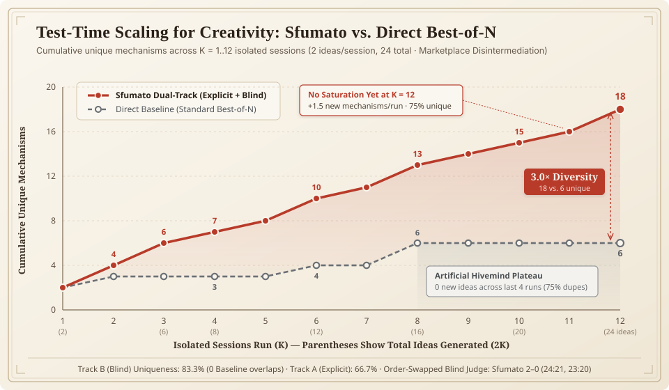
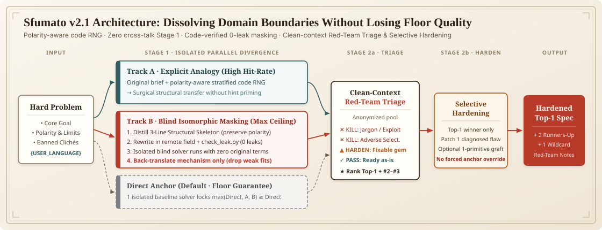

<div align="center">

<p align="center">
  
  &nbsp;&nbsp;
  
  &nbsp;&nbsp;
  
</p>

# 🎨 Sfumato

### *Dissolve domain boundaries. Break the Artificial Hivemind. Unlock Test-Time Scaling for Creativity.*

<p>
  <a href="./README.md"><strong>English</strong></a> · <a href="./README.ko.md">한국어</a>
</p>

<p>
  
  
  
  
  
</p>

<sub>Created by <strong>Excelsus4</strong> with <strong>Gemini 4 Neon</strong> · All K=1..12 scaling experiments benchmarked on Gemini 4 Neon (High).</sub>

> *"Sfumato" (Italian: evaporated like smoke) is Leonardo da Vinci's painting technique of dissolving harsh outlines so entirely new forms emerge. Leonardo didn't stay inside one discipline — he ported anatomy, fluid dynamics, fortification, and optics into each other.*
>
> **Sfumato** is an ultra-lightweight agent skill (`/sfumato`, `/sfm`) that does the same for frontier LLMs — **with zero external RAG, zero fine-tuning, and zero dependencies.**

</div>

---

## 🔥 The Problem: Standard LLMs Hit an *Artificial Hivemind* Wall

For coding and reasoning, **clean, strictly relevant context** is king. Irrelevant context distracts attention and kills accuracy.

**For brainstorming, the exact opposite happens.**

When you ask an LLM to brainstorm a hard open-ended problem — even across 12 completely isolated sessions — it collapses into the same 3–6 safe textbook clichés (*Artificial Hivemind*, NeurIPS). Raising `temperature` breaks coherence before it creates real conceptual leaps. Multi-agent debate makes it *worse* (*Diversity Collapse*).

> **🧪 Real Smoking Gun from Our Pilot (`OSS-PR`):**
> Across isolated runs solving *"how to stop AI-generated slop PRs in open-source repos"*, **three completely separate sessions** (`Direct Baseline 1`, `Direct Baseline 2`, and even an `Explicit Thermodynamics` session) **independently invented the exact same example package string: `pkg@pr-4821` / `pkg@patch-4821`.**
>
> **Zero** sessions in Sfumato's **Blind Isomorphic Masking** track touched `4821` — or any Baseline cliché.

---

## 📈 Test-Time Scaling for Creativity (Real Measured Data, `K = 1..12`)

We ran **12 completely isolated sessions (24 ideas each)** on a classic hard product problem — *stopping buyer-seller disintermediation (off-platform cash deals) in two-sided marketplaces without chat surveillance, fines, or deficit subsidies* — using strict deduplication of underlying causal mechanisms:

<p align="center">
  
</p>

| Metric (`K = 12` isolated runs, 24 ideas each) | Direct Best-of-N | **Sfumato Dual-Track** | Delta |
|---|---:|---:|---:|
| **Unique Structural Mechanisms Discovered** | `6 / 24` (`25.0%`) | **`18 / 24` (`75.0%`)** | **3.0×** |
| **New Mechanisms in Runs 9–12 (last 8 ideas)** | `0` *(hard plateau)* | **`+5` *(still climbing)* ** | **∞** |
| **Track B (Blind) Uniqueness / Baseline Overlap** | — | **`83.3%` / `0` overlaps** | Zero cliché gravity |
| **Order-Swapped Blind A/B Judge (`AB` & `BA`)** | `0–2` *(21:24, 20:23)* | **`2–0` Win *(24:21, 23:20)*** | Position-debiased |

> **Key Takeaway:** Swinging harder with **Direct Best-of-N** doesn't work — it flatlines at `6` mechanisms (75% repetition). **Sfumato unlocks Test-Time Scaling for Creativity:** every additional swing explores a genuinely orthogonal mechanism cluster, pushing the **maximum creativity ceiling (Top-1)** higher.

---

## 🏛️ How Sfumato Works: The *Domain-Masking Trade-Off*

Most cross-domain prompting papers use **Explicit Analogy** (*"apply biology to solve marketplace churn"*). Because the original problem's words stay in the prompt, the LLM still suffers **partial homogenization** back toward industry clichés.

Conversely, **pure Blind Reframing** (hiding the original problem completely) breaks cliché gravity 100%, but has a lower hit-rate because some abstract solutions don't translate cleanly back.

**Sfumato pairs both tracks in parallel — then passes unlabeled candidates through a fresh Clean-Context Red-Team Gate:**

<p align="center">
  
</p>

1. **Cluster-Stratified Code RNG (`sample_domains.py`):** Never ask an LLM to "pick random domains" (it repeats *ants, jazz, and chess*). Sfumato samples from **40 mechanism-rich domains across 8 disjoint macro-clusters** using pure Python `random`.
2. **Track A — Explicit Analogy *(High Hit-Rate)*:** Original brief + assigned remote domain → surgical hits against domain-specific attack surfaces.
3. **Track B — Blind Isomorphic Masking *(Max Ceiling)*:**
   - Erase **100% of original-domain vocabulary** while preserving **incentive polarity** (*zero-sum vs. cooperative vs. platform-refereed*).
   - A fresh, isolated subagent solves the masked twin purely inside the remote field — **physically incapable of emitting original-domain clichés.**
   - Back-translate only the causal mechanism & trade-off (ruthlessly discard strained translations).
4. **Direct Anchor *(`deep` mode · Floor Guarantee)*:** Includes 1 isolated Direct Baseline solver in the unlabeled pool so `max(Direct, Explicit, Blind) ≥ Direct` — never worse than standard prompting on engineering-native problems.
5. **Stage 2 — Clean-Context Red-Team Gate:** A fresh, uncontaminated evaluator cuts surface jargon cosplay, screens every candidate for **Adverse Selection**, **Sybil/Wash-Trading exploits**, and **feasibility**, then ranks for **Peak Top-1 Ceiling** (plus 2 distinct runners-up & 1 optional wildcard).

---

## ⚡ Before / After Showcase: Marketplace Disintermediation (`MKT-DIS`)

> **Problem:** Freelancers, tutors, cleaners, and contractors meet buyers on a platform, then move to WhatsApp/cash for repeat jobs to dodge the 10–20% fee. *Banned clichés: chat filtering, fines, simple escrow/insurance, cashbacks, or 0% fees.*

| Method | What It Produced | Why It Differs |
|---|---|---|
| **Direct Best-of-N**<br>*(12 runs, 24 ideas)* | Repeated the same 3 core ideas 18 times: *T+0 Reverse Escrow*, *Transferable Client-Book*, *Idle-Slot Backfill*. | High practical quality, but stuck inside the exact same fintech/ops playbook. |
| **Sfumato · Winner**<br>*(Parasitology · Two-Fold Cost of Sex)* | **🏆 Chimeric Task Recombination** *(Blind Judge 2–0 Winner)* — Redirect 5–7% of the repeat fee into an independent **3rd-party cross-verification slot every N sessions** (blind mock-exam for tutoring, thermal/level cross-inspection for renovations, senior async review for code). | Direct 1:1 cash deals *physically cannot* replicate independent 3rd-party checks, collapsing the collusion price zone — and **proposing cash off-platform becomes a "Lemon Signal" of dodging quality audit.** |
| **Sfumato · Track B Blind**<br>*(Ombudsman & Cryptographic Whistleblowing)* | **Zero-Knowledge Safe-Harbor Attestation** — Seal pricing/deliverable commits + retaliation-proof whistleblower absence proof so corporate/HOA/team buyers get **audit-proof anti-kickback immunity**. | Reframed disintermediation from "saving 15%" into "eliminating embezzlement/kickback liability for institutional buyers." |
| **Sfumato · Track B Blind**<br>*(Anthropology · Kula Ring)* | **Kula Pedigree Provenance Chain** — On-platform jobs stamp verifiable craftsman lineage onto outputs (boosting home resale value, VC/M&A IP due diligence, or credential portability). | Off-platform work becomes an "unpedigreed nameless artifact" that loses downstream third-party resale value. |
| **Sfumato · Red-Team Catch**<br>*(Fluid Dynamics · Venturi Ejector)* | **Venturi Negative-Fee Capacity Suction** — Charge *-3%* (buyer pays 90, supplier gets 93) funded by ±24–48h shift call-options exercised during urgent B2B spikes (160). | Brilliant physics transfer — **and Sfumato's v1.2 Red-Team Gate instantly caught its wash-trading arbitrage exploit (90→93)** before it could steal Top-1! |

<details>
<summary><strong>📊 Inspect All 18 Unique Sfumato Mechanisms vs. 6 Direct Mechanisms (Full K = 1..12 Log)</strong></summary>

<br/>

#### Direct Best-of-N (`K = 1..12`, 24 ideas → **6 unique**, flatlined at K=8)
1. **Transferable Client-Book & Succession Royalty** *(appeared 6× across 12 runs)*
2. **T+0 Reverse-Escrow / Maturity Transformation** *(appeared 6×)*
3. **Idle-Slot Backfill & Context-Synced Hot-Swap** *(appeared 6×)*
4. **Anchor-Client Patronage Revenue-Share Equity** *(appeared 4×)*
5. **Perishable-Capacity In-Kind Barter Fee** *(1×)*
6. **B2B Wholesale Input & Tax-Arbitrage Rail** *(3×)*

#### Sfumato Dual-Track (`K = 1..12`, 24 ideas → **18 unique**, still climbing at K=12)
| Run | Track · Remote Domain | New Unique Mechanisms Discovered | Cum. |
|---:|---|---|---:|
| 1 | Explicit · `fluid_microfluidics` | ① Venturi Negative-Fee Shift-Option Suction · ② Laminar Co-Flow Unbundling | 2 |
| 2 | Blind · `maritime_trade_guilds` | ③ Multilateral Giro Netting Ledger · ④ Manifest Co-Loading & Third-Party Lien Shield | 4 |
| 3 | Explicit · `parasitology_coevolution` | ⑤ **Chimeric Cross-Recombination (🏆 2–0 Winner)** · ⑥ Reverse-Escrow Metabolic Decoupling | 6 |
| 4 | Blind · `horology_escapement` | ⑦ Differential Remontoir Income/Capacity Smoothing *(1 discarded: translation loss)* | 7 |
| 5 | Explicit · `disaster_triage` | ⑧ Dynamic Retriage Scope-Creep Shield *(1 overlapped Co-Flow)* | 8 |
| 6 | Blind · `container_port_logistics` | ⑨ Dual-Cycling Return-Leg Backhaul Chaining · ⑩ Buffer-Yard Drop-and-Hook Async Decoupling | 10 |
| 7 | Explicit · `siege_fortification` | ⑪ Metered Tool-License & Unused-Material Return Magazine *(1 overlapped Backup)* | 11 |
| 8 | Blind · `ombudsman_whistleblower` | ⑫ Zero-Knowledge Anti-Kickback Safe-Harbor · ⑬ Threshold Anonymous Subcontractor Early-Warning | 13 |
| 9 | Explicit · `architectural_wayfinding` | ⑭ Open-Atrium Live Work-Log Showroom (CPTED Natural Surveillance) *(1 overlapped Backhaul)* | 14 |
| 10 | Blind · `electronic_warfare_pls` | ⑮ Global Conflict-Aligned Multi-Party Schedule Multiplexing *(1 discarded: translation loss)* | 15 |
| 11 | Explicit · `mycorrhizal_plant_defense` | ⑯ Tri-Trophic External Insurer/Lender Priming Signal *(1 overlapped Clearing)* | 16 |
| 12 | Blind · `gift_economy_reciprocity` | ⑰ Kula Pedigree Resale-Value Provenance · ⑱ Potlatch/Hau Generalized Triadic Time-Bank Ring | **18** |

</details>

---

## 🚀 Quick Start (Zero Dependencies)

Sfumato is just **4 lightweight files** (`SKILL.md`, `domain_pool.json`, `sample_domains.py`, `prompt_templates.md`). Drop it into your agent's global skills folder:

```bash
# Claude Code (skill + optional /sfm 3-letter shortcut)
cp -r skill/sfumato ~/.claude/skills/sfumato
cp commands/sfm.md ~/.claude/commands/sfm.md

# Antigravity (agy)
cp -r skill/sfumato ~/.gemini/config/skills/sfumato

# Codex CLI
cp -r skill/sfumato ~/.codex/skills/sfumato
```

### Usage

```text
/sfm Design a non-obvious mechanic to prevent snowballing in a 3-faction asymmetric RTS
/sfumato deep mode: How do we defend open-source repos from AI-slop PR floods without paywalls?
```

| Mode | Pipeline | Best For |
|---|---|---|
| `dual-track` *(default)* | `2 Explicit + 2 Blind` → Red-Team Selector | Everyday high-ceiling brainstorming |
| `deep` | `1 Direct Anchor + 3 Explicit + 3 Blind` → Red-Team Selector | Stuck strategic problems (guarantees `≥ Direct` floor) |
| `fast` | `3 Explicit` → Red-Team Selector | Quick practical hits under tight token budgets |

---

## 📚 Research Foundations

Sfumato builds directly on four converging lines of 2024–2026 LLM creativity research:
- **Artificial Hivemind** — Jiang et al. (*NeurIPS Best Paper*): documents intra- and inter-model homogenization on open-ended ideation.
- **Diversity Collapse in Multi-Agent LLM Systems** — shows dense debate/consensus topologies crush semantic diversity; motivates Sfumato's strict **zero-crosstalk** parallel Stage 1.
- **Unlocking LLM Creativity in Science through Analogical Reasoning** (Shen et al., 2026) & **Assessing Cross-Domain Mapping in Humans and LLMs** (Liu et al., 2026) — validates structural relational transfer over surface metaphors.
- **Sfumato's Distinct Contribution:** Formalizes the **Domain-Masking Trade-Off** between *Explicit Analogy* (high hit-rate, partial homogenization) and *Blind Isomorphic Masking* (lower hit-rate, zero cliché gravity, heavy-tail mutations), unified with a **Direct Anchor** and **Clean-Context Red-Team Gate**.

---

<div align="center">


*“Where the spirit does not work with the hand, there is no art.” — Leonardo da Vinci*

<sub>All Leonardo da Vinci artworks are Public Domain via Wikimedia Commons.</sub>

</div>
