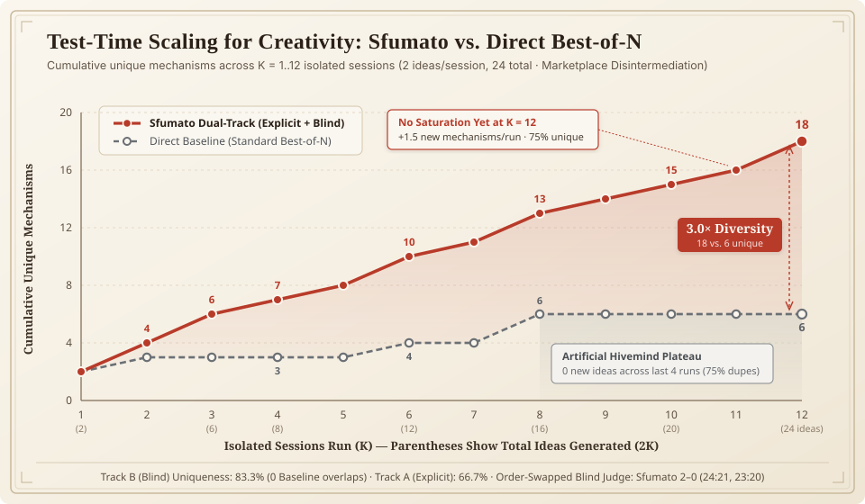
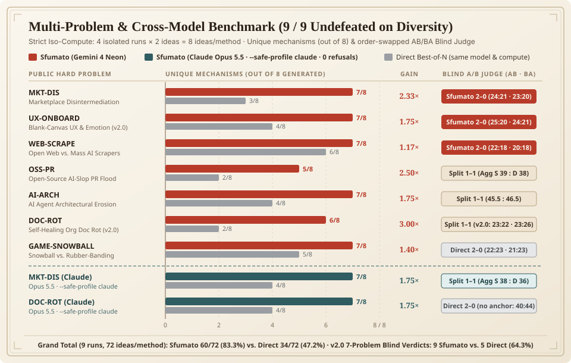
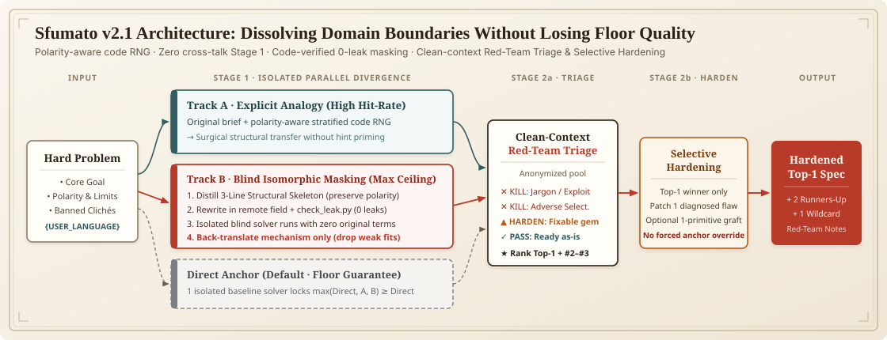

<div align="center">

<p align="center">
  
  &nbsp;&nbsp;
  
  &nbsp;&nbsp;
  
</p>

# 🎨 Sfumato

### *Стираем границы доменов. Разрушаем «искусственный роевой разум». Открываем Test-Time Scaling для разнообразия поиска.*

<p>
  <a href="./README.md">English</a> · <a href="./README.ko.md">한국어</a> · <a href="./README.ru.md"><strong>Русский</strong></a> · <a href="./README.zh-CN.md">简体中文</a>
</p>

<p>
  
  
  
  
</p>

> *«Сфумато» (итал. sfumato — «исчезающий как дым») — живописная техника Леонардо да Винчи, размывающая жёсткие контуры ради рождения новых форм. Леонардо не замыкался в одной дисциплине — он переносил принципы анатомии, гидродинамики, фортификации и оптики друг в друга.*
>
> **Sfumato** — сверхлёгкий скилл для ИИ-агентов (`/sfumato`, `/sfm`), делающий то же самое для современных LLM — **4 открытых текстовых файла, без внешнего RAG, без дообучения и без сторонних зависимостей.**

</div>

---

## 🔥 Проблема: стандартные LLM упираются в стену *Artificial Hivemind*

В кодинге и строгом рассуждении **чистый, строго релевантный контекст** — главный фактор успеха. Лишняя информация отвлекает внимание и снижает точность.

**В мозговом штурме происходит ровно обратное.**

Когда вы просите LLM решить сложную открытую задачу — даже в 12 полностью изолированных сессиях — модель схлопывается в одни и те же 3–6 безопасных учебниковых клише (*Artificial Hivemind*, NeurIPS 2025). Повышение `temperature` разрушает связность раньше, чем даёт реальный концептуальный скачок. А мультиагентные дебаты делают ситуацию только *хуже* (*Diversity Collapse*, 2026).

> **🧪 Прямая улика из нашего пилота (`OSS-PR`):**
> В изолированных запусках задачи *«как остановить поток ИИ-слоп PR в open-source репозиториях»* **три совершенно независимые сессии** (`Direct Baseline 1`, `Direct Baseline 2` и даже `Explicit Thermodynamics`) **независимо придумали один и тот же пример имени пакета: `pkg@pr-4821` / `pkg@patch-4821`.**
>
> В треке **Blind Isomorphic Masking** от Sfumato **ни одна** сессия не скатилась ни в `4821`, ни в клише Baseline.

---

## 📈 Test-Time Scaling для разнообразия поиска (реальные замеры, `K = 1..12`)

Мы провели **12 полностью изолированных сессий (по 24 идеи на метод)** на классической сложной продуктовой задаче — *предотвращение обхода платформы (прямых сделок за наличные между покупателем и исполнителем) на двустороннем маркетплейсе без слежки за чатами, штрафов и убыточных субсидий* — со строгой дедупликацией базовых причинных механизмов:

<p align="center">
  
</p>

| Метрика (`K = 12` изолированных запусков, по 24 идеи) | Direct Best-of-N | **Sfumato Dual-Track** | Разница |
|---|---:|---:|---:|
| **Уникальных структурных механизмов найдено** | `6 / 24` (`25.0%`) | **`18 / 24` (`75.0%`)** | **3.0×** |
| **Новых механизмов в запусках 9–12 (последние 8 идей)** | `0` *(жёсткое плато)* | **`+5` *(рост продолжается)*** | **Без плато** |
| **Уникальность Track B (Blind) / пересечения с Baseline** | — | **`83.3%` / `0` пересечений** | Нулевая гравитация клише |
| **Слепой A/B-судья с перестановкой порядка (`AB` и `BA`)** | `0–2` *(21:24, 20:23)* | **`2–0` победа *(24:21, 23:20)*** | Без позиционного смещения |

> **Главный вывод:** просто увеличивать число попыток **Direct Best-of-N** бесполезно — он упирается в потолок на `6` механизмах (75% повторов). **Sfumato открывает Test-Time Scaling для разнообразия поиска:** каждый дополнительный запуск исследует ортогональный кластер механизмов, расширяя фронтир неочевидных кандидатов.

---

## 🌍 Мультизадачный и кросс-модельный бенчмарк (`9 / 9` побед по разнообразию)

Работает ли это за пределами теории игр в маркетплейсах — включая **эмоциональный UX-дизайн**, **защиту открытого веба от ИИ-скраперов**, **архитектуру ПО** и **другие флагманские модели** вроде **Claude Opus 5.5**?

Мы провели бенчмарки с **равным бюджетом кандидатов (`Iso-Candidate-Budget`: 4 изолированных солвера Stage 1 × 2 идеи = 8 кандидатов на метод, слепые судьи с перестановкой `AB`/`BA`)** на **7 публичных сложных задачах** на Gemini 4 Neon плюс **2 кросс-модельных воспроизведения** на **Claude Opus 5.5** с флагом `--safe-profile claude` (исключает 8 чувствительных био/CBRN/кибер/шпионских доменов, давая **0 ложных отказов безопасности за 24 изолированных вызова**). *(Примечание: при равном бюджете кандидатов Stage 1 Sfumato добавляет этапы маскирования/обратного перевода координатора и оценку Stage 2a/2b — см. таблицу стоимости ниже.)*

<p align="center">
  
</p>

### Основные запуски (100% совпадение с `python tools/summarize_benchmarks.py benchmarks/v2 --strict`)

| Публичная сложная задача | Модель | Direct уник./8 | Sfumato уник./8 | Прирост | Слепой `AB · BA` (из 30) | Вердикт |
|---|---|---:|---:|---:|---|---|
| **`MKT-DIS`** *(Обход маркетплейса)* | Gemini 4 Neon | 3 / 8 | **7 / 8** | **2.33×** | **24:21 · 23:20** | **Sfumato 2–0** |
| **`UX-ONBOARD`** *(Страх чистого листа · UX/эмоции, v2.0)* | Gemini 4 Neon | 4 / 8 | **7 / 8** | **1.75×** | **25:20 · 24:21** | **Sfumato 2–0** |
| **`WEB-SCRAPE`** *(Открытый веб против ИИ-скраперов)* | Gemini 4 Neon | 6 / 8 | **7 / 8** | **1.17×** | **22:18 · 20:18** | **Sfumato 2–0** |
| **`OSS-PR`** *(Поток ИИ-слоп PR в Open Source)* | Gemini 4 Neon | 2 / 8 | **5 / 8** | **2.50×** | **21:17 · 18:21** | **Ничья 1–1** |
| **`AI-ARCH`** *(Архитектурная эрозия от ИИ-агентов)* | Gemini 4 Neon | 4 / 8 | **7 / 8** | **1.75×** | **23:22.5 · 22.5:24** | **Ничья 1–1** |
| **`DOC-ROT`** *(Устаревание документации, v1.2 базовый)* | Gemini 4 Neon | 2 / 8 | **6 / 8** | **3.00×** | 22:24 · 21:24 | Direct 2–0 *(см. абляцию v2.0)* |
| **`GAME-SNOWBALL`** *(Снежный ком vs выравнивание, v1.2)* | Gemini 4 Neon | 5 / 8 | **7 / 8** | **1.40×** | 22:23 · 21:23 | Direct 2–0 *(см. абляцию v2.0)* |
| **`MKT-DIS`** *(Кросс-модель · `--safe-profile claude`)* | **Claude Opus 5.5** | 4 / 8 | **7 / 8** | **1.75×** | 18:19 · **20:17** | **Ничья 1–1** *(0 отказов)* |
| **`DOC-ROT`** *(Кросс-модель · `--safe-profile claude`)* | **Claude Opus 5.5** | 4 / 8 | **7 / 8** | **1.75×** | 20:22 · 20:22 | Direct 2–0 *(без Anchor · 0 отказов)* |
| **Итого (9 основных запусков · 72 идеи на метод)** | **2 модели** | `34 / 72` (`47.2%`) | **`60 / 72` (`83.3%`)** | **1.76×** | **9 Sfumato : 9 Direct** | **9/9 Разнообразие · 3W / 3T / 3L** |

### Абляции v2.0 Stage 2b Equal-Hardening (показаны и прирост, и регрессия)

| Задача | v1.2 базовый (`S:D`) | v2.0 Equal-Hardening (`S:D`) | Дельта Sfumato | Вердикт и вывод |
|---|---:|---:|---:|---|
| **`DOC-ROT`** | `43 : 48` *(0–2)* | **`46 : 48`** *(23:22 · 23:26)* | **+3** | **Ничья 1–1** — точечное усиление кросс-доменной идеи (`thermodynamics_cryogenics`) закрыло разрыв |
| **`GAME-SNOWBALL`** *(пул v1.2, насильств. привитие)* | `43 : 46` *(0–2)* | `39 : 45` *(20:22 · 19:23)* | **−4** | **Direct 2–0** — насильственное привитие неподходящего по полярности домена ухудшает результат; не перебивайте сильный Anchor |
| **`GAME-SNOWBALL`** *(Pool v2.0: 74 домена / 11 кластеров)* | `43 : 46` *(0–2)* | **`46 : 39`** *(8/8 уник.)* | **+3** | **Sfumato 2–0** — расширение пула (когнитивистика, материалы, энергосети) устранило мисматч полярности ([лог](./benchmarks/v2/ablations/game_snowball_pool_v2_results.json)) |

### Независимый кросс-модельный слепой аудит (устранение смещения самооценки)

Чтобы исключить предпочтение собственной модели, **Claude Opus 5.5** независимо (read-only, перестановка `AB`/`BA`) оценил все **7 основных пар победителей Gemini 4 Neon** ([`benchmarks/v2/cross_model_judges/claude_on_gemini.json`](./benchmarks/v2/cross_model_judges/claude_on_gemini.json)):

- **Итог кросс-модельного судьи:** **3 победы (`MKT-DIS` 2–0, `WEB-SCRAPE` 2–0, `AI-ARCH` 2–0), 1 ничья (`GAME-SNOWBALL` 1–1), 3 поражения (`UX-ONBOARD`, `OSS-PR`, `DOC-ROT` v1.2)** — **7 Sfumato против 7 Direct** (0 позиционного смещения в 6 из 7 задач).
- **Что честно показывают данные:**
  - **Инвариантное к модели преимущество:** **9 / 9 побед по разнообразию (`1.76×` при K=4, `3.0×` при K=12)** — стабильное открытие новых классов механизмов, подтверждённое победами 2–0 у *обоих* судей на `MKT-DIS` и `WEB-SCRAPE` (и на `AI-ARCH` у Claude).
  - **Честные ограничения (`n=1` сид на задачу):** одноразовый Top-1 против сильного 4-кратного Direct Best-of-N находится в паритете (`9:9` базовый, `7:7` кросс-судья), а Track B чаще служит источником нестандартных «джокеров» и переформулировок, чем прямым победителем. Поэтому **Sfumato v2.2 включает Direct Anchor по умолчанию** в `dual-track` и `deep`, фиксируя нижнюю границу (`≥ Direct`) при расширении поиска в 1.7–3.0×.
- **Воспроизводимые материалы и сквозная трасса выполнения:**
  - Локальная проверка всех 9 запусков и 2 абляций v2.0 Stage 2b (`v2_ablation_*.json`): `python tools/summarize_benchmarks.py benchmarks/v2 --strict` *(отдельный запуск Pool v2.0 записан в [`game_snowball_pool_v2_results.json`](./benchmarks/v2/ablations/game_snowball_pool_v2_results.json))*
  - Структурированные сводки бенчмарков и обоснования судей: [`benchmarks/v2/`](./benchmarks/v2/)
  - Независимый кросс-модельный аудит Claude Opus 5.5: [`benchmarks/v2/cross_model_judges/claude_on_gemini.json`](./benchmarks/v2/cross_model_judges/claude_on_gemini.json)
  - Архивная сквозная трасса выполнения v2.1 (`sample_domains.py` → 4 изолированных солвера → Stage 2a `PASS/HARDEN/KILL` → Stage 2b Hardening; в v2.2 regex-скрипт из этого архива убран в пользу общего скелета и сквозной перепроверки промпта): [`benchmarks/v2/transcripts/alert_fatigue_v2_1_full_transcript.md`](./benchmarks/v2/transcripts/alert_fatigue_v2_1_full_transcript.md)

---

## 🏛️ Как работает Sfumato v2.2: *компромисс маскировки домена*

Большинство работ по междисциплинарному промптингу используют только **явную аналогию (Explicit Analogy)**. Поскольку термины исходной задачи остаются в промпте, LLM всё равно страдает от **частичной гомогенизации**. Чистое **слепое переформулирование (Blind Reframing)** на 100% отключает гравитацию клише, но имеет меньший процент попаданий из-за потерь при обратном переводе.

**Sfumato v2.2 объединяет Direct Anchor и оба кросс-доменных трека параллельно в полной изоляции, добавляя учёт полярности, маскирование через общий структурный скелет и Red-Team триаж с выборочным усилением:**

<p align="center">
  
</p>

1. **Стратифицированный ГСЧ с учётом полярности (`sample_domains.py`):** **74 домена в 11 непересекающихся макрокластерах** через стандартный `random` Python. По умолчанию опускает подсказки `mechanisms` (защита от мини-гомогенизации; опция `--include-hints`). Флаг `--polarity` (`adversarial | cooperative | physical_loop | human_ux | systems_ops`) мягко подбирает не менее половины доменов с подходящей структурной полярностью. На Claude Code флаг `--safe-profile claude` оставляет **66 безопасных доменов (ровно по 6 в каждом из 11 кластеров)** и даёт **0 отказов безопасности**.
2. **Direct Anchor *(по умолчанию в `dual-track` и `deep` · гарантия минимума)*:** 1 изолированное прямое решение в анонимном пуле гарантирует `max(Direct, Explicit, Blind) ≥ Direct`.
3. **Track A — Явная аналогия *(высокая точность)*:** исходный бриф + удалённый домен → точечный структурный перенос.
4. **Track B — Слепое изоморфное маскирование *(максимальный потолок · общий 3-строчный скелет + нативные ограничения)*:**
   - Сжатие задачи в один приватный **3-строчный доменно-нейтральный скелет** (акторы, носитель издержек и полярность · ключевая асимметрия · причина отказа статических мер) с проверкой полярности до запуска.
   - Переписывание в самостоятельный сценарий целевого домена на `{USER_LANGUAGE}` с встраиванием запрещённых клише как естественных ограничений области и сквозной перепроверкой всего исходящего промпта (правдоподобие для практика, отсутствие исходного жаргона, сохранение полярности).
   - Изолированный субагент решает замаскированную задачу внутри удалённой дисциплины — **физически не имея доступа к исходным клише.**
   - Обратно переводится только причинный механизм и его компромисс.
5. **Stage 2a/2b — Red-Team триаж (`PASS / HARDEN / KILL`) и выборочное усиление:**
   - **Stage 2a:** чистый оценщик отсекает «косплей жаргона», проверяет на неблагоприятный отбор, сибил-эксплойты и реализуемость и размечает кандидатов как `PASS`, `HARDEN` (с указанием 1 исправимой слабости) или `KILL`.
   - **Stage 2b:** усиливает *только* единичную диагностированную слабость победителя Top-1 (при необходимости прививая 1 практический примитив от прошедшего призёра — без насильственной замены сильного Direct Anchor).
   - **Языково-нейтральные шаблоны:** все шаблоны в `prompt_templates.md` и `domain_pool.json` написаны на английском с явной директивой `Respond in {USER_LANGUAGE}.`, обеспечивая корректный вывод на языке пользователя.

---

## ⚡ Пример «До / После»: обход двустороннего маркетплейса (`MKT-DIS`)

> **Задача:** фрилансеры, репетиторы, клинеры и подрядчики находят клиентов на платформе, а затем уходят в WhatsApp/наличные ради экономии 10–20% комиссии. *Запрещённые клише: фильтрация чатов, штрафы, базовый эскроу/страховка, кэшбэк, 0% комиссия.*

| Метод | Результат | В чём принципиальное отличие |
|---|---|---|
| **Direct Best-of-N**<br>*(12 запусков, 24 идеи)* | 18 раз повторил одни и те же 3 идеи: *T+0 обратный эскроу*, *передаваемая клиентская книга*, *заполнение отменённых слотов*. | Практично, но заперто внутри стандартного финтех-справочника. |
| **Sfumato · Победитель**<br>*(Паразитология · Двойная цена пола)* | **🏆 Химерная рекомбинация задач** *(Победа 2–0 у судей Gemini и Claude)* — направлять 5–7% повторной комиссии в независимый **слот перекрёстной проверки 3-й стороной каждые N сессий** (слепой пробный экзамен в репетиторстве, тепловизор/инспекция в ремонте, асинхронное ревью сеньора в коде). | Прямая сделка 1:1 за наличные *физически не способна* воспроизвести независимый аудит, а **предложение уйти в наличные превращается в «сигнал лимона» (уход от проверки качества).** |
| **Sfumato · Track B Blind**<br>*(Омбудсмен и криптографическое оповещение)* | **Zero-Knowledge Safe-Harbor Attestation** — фиксация цен/результатов + доказательство отсутствия жалоб для защиты корпоративных/ТСЖ-заказчиков от обвинений в откатах. | Переосмыслил уход с платформы с «экономии 15%» на «юридический риск откатов для институционального покупателя». |
| **Sfumato · Track B Blind**<br>*(Антропология · Кольцо Кула)* | **Цепочка родословной Kula** — сделки на платформе впечатывают проверяемую родословную мастера в результат (повышая стоимость перепродажи дома или IP due diligence). | Внеплатформенная работа становится «безымянным артефактом», теряя вторичную рыночную стоимость. |
| **Sfumato · Защита Red-Team**<br>*(Гидродинамика · Эжектор Вентури)* | **Отрицательная комиссия Вентури** — комиссия *-3%* (покупатель платит 90, исполнитель получает 93) за счёт опционов сдвига на срочных B2B-пиках (160). | Яркий физический перенос — **но Red-Team Gate мгновенно поймал фиктивный арбитраж (90→93)** до выхода в Top-1. |

<details>
<summary><strong>📊 Посмотреть все 18 уникальных механизмов Sfumato против 6 у Direct (полный лог K = 1..12)</strong></summary>

<br/>

#### Direct Best-of-N (`K = 1..12`, 24 идеи → **6 уникальных**, плато с K=8)
1. **Передаваемая клиентская книга и роялти преемственности** *(6× из 12 запусков)*
2. **T+0 обратный эскроу / трансформация сроков** *(6×)*
3. **Заполнение пустых слотов и горячая замена** *(6×)*
4. **Доля от выручки якорных клиентов** *(4×)*
5. **Бартерная оплата комиссии свободными слотами** *(1×)*
6. **Оптовые закупки B2B и налоговый рельс** *(3×)*

#### Sfumato Dual-Track (`K = 1..12`, 24 идеи → **18 уникальных**, рост продолжается на K=12)
| № | Трек · Домен | Новые уникальные механизмы | Сумма |
|---:|---|---|---:|
| 1 | Explicit · `fluid_microfluidics` | ① Отрицательная комиссия Вентури · ② Ламинарное расслоение потоков | 2 |
| 2 | Blind · `maritime_trade_guilds` | ③ Многосторонний клиринг Жиро · ④ Сборный манифест и защита права удержания 3-й стороны | 4 |
| 3 | Explicit · `parasitology_coevolution` | ⑤ **Химерная перекрёстная рекомбинация (🏆 2–0)** · ⑥ Метаболическая развязка эскроу | 6 |
| 4 | Blind · `horology_escapement` | ⑦ Дифференциальный ремонтуар сглаживания дохода *(1 отброшена при переводе)* | 7 |
| 5 | Explicit · `disaster_triage` | ⑧ Динамическая сортировка против расползания скоупа *(1 совпадение)* | 8 |
| 6 | Blind · `container_port_logistics` | ⑨ Двойной цикл обратных рейсов · ⑩ Буферная развязка Drop-and-Hook | 10 |
| 7 | Explicit · `siege_fortification` | ⑪ Повременный склад инструментов и возврат остатков материалов *(1 совпадение)* | 11 |
| 8 | Blind · `ombudsman_whistleblower` | ⑫ Zero-Knowledge защита от откатов · ⑬ Пороговое анонимное предупреждение субподрядчиков | 13 |
| 9 | Explicit · `architectural_wayfinding` | ⑭ Открытый атриум живого лога работ (CPTED) *(1 совпадение)* | 14 |
| 10 | Blind · `electronic_warfare_pls` | ⑮ Глобальное мультиплексирование расписаний *(1 отброшена при переводе)* | 15 |
| 11 | Explicit · `mycorrhizal_plant_defense` | ⑯ Трёхтрофический сигнал для внешних страховщиков/кредиторов *(1 совпадение)* | 16 |
| 12 | Blind · `gift_economy_reciprocity` | ⑰ Родословная перепродажи Кула · ⑱ Отложенный взаимный банк времени Потлач/Хау | **18** |

</details>

---

## 🚀 Установка и использование (4 текстовых файла · 0 зависимостей)

Всё необходимое находится в [`skill/sfumato/`](./skill/sfumato/) — **4 открытых файла**:
- `SKILL.md` — инструкции скилла, мультиагентный гайд (Claude Code / Antigravity / Codex CLI) и порядок работы
- `references/prompt_templates.md` — языково-нейтральные (`{USER_LANGUAGE}`) шаблоны Anchor, Explicit, Blind, Stage 2a и Stage 2b
- `resources/domain_pool.json` — 74 домена в 11 макрокластерах (`66` Claude-safe, по 6 на кластер) с тегами полярности (`affinities`)
- `scripts/sample_domains.py` — стратифицированный сэмплер с учётом полярности на чистом stdlib Python (без сети и записи на диск)

Склонируйте репозиторий, проверьте файлы и скопируйте `skill/sfumato` в глобальную папку скиллов вашего агента:

```bash
git clone https://github.com/Excelsus4/sfumato.git && cd sfumato

# Claude Code (+ шорткаты /sfm и /sfm-max с --safe-profile claude)
cp -r skill/sfumato ~/.claude/skills/sfumato
cp commands/*.md ~/.claude/commands/

# Antigravity (agy)
cp -r skill/sfumato ~/.gemini/config/skills/sfumato

# Codex CLI
cp -r skill/sfumato ~/.codex/skills/sfumato
```

<details>
<summary>Опциональный локальный помощник копирования (поддерживает <code>--dry-run</code> после клонирования)</summary>

```bash
# macOS / Linux
bash tools/install.sh --dry-run
bash tools/install.sh --target claude   # или agy | codex | all | auto
```

```powershell
# Windows PowerShell
.\tools\install.ps1 -DryRun
.\tools\install.ps1 -Target claude      # или agy | codex | all | auto
```

</details>

### Использование и бюджет вычислений

```text
/sfm Придумай неочевидную механику против эффекта снежного кома в асимметричной RTS на 3 фракции
/sfumato deep mode: Как защитить open-source репозитории от потока ИИ-слоп PR без пейволлов?
/sfm-max Полный обход всех 11 кластеров для поиска 3-летнего нелинейного рва удержания
```

| Режим | Солверы Stage 1 | Всего изолированных вызовов | Оценка токенов (к 1 Direct) | Для чего лучше всего |
|---|---|---:|---:|---|
| `fast` | `3 Explicit` (`--k 3 --mode explicit-only`) | `4` *(3 + Stage 2a)* | ~4–5× | Быстрые кросс-доменные идеи при жёстком бюджете токенов |
| `dual-track` *(по умолчанию)* | `1 Direct Anchor + 2 Explicit + 1 Blind` (`--k 3`) | `5–6` *(4 + Stage 2a + опц. 2b)* | ~6–8× | Повседневный брейнсторминг (соответствует бенчмарку; гарантия `≥ Direct`) |
| `deep` | `1 Direct Anchor + 3 Explicit + 3 Blind` (`--k 6`) | `8–9` *(7 + Stage 2a + опц. 2b)* | ~10–12× | Сложные стратегические/архитектурные тупики с максимальной шириной поиска |
| `sweep` *(опционально)* | `1 Direct Anchor + 11 доменов` (`--k 11`, по 1/кластер) | `13–14` *(12 + Stage 2a + опц. 2b)* | ~15–18× | Полное покрытие всех 11 кластеров за одну волну |
| `max` (`/sfm-max`, *опционально*) | **Все 66 (Claude) / 74 домена** (`--all`) + **1 Direct Anchor** → **турнир в 2 раунда** | `79–80` / `87–88` | ~80–90× | Исчерпывающий поиск *(всегда запрашивает подтверждение числа сессий)* |

---

## 📚 Исследовательская база

Sfumato опирается на четыре сходящихся направления исследований креативности LLM (2025–2026):
- **Artificial Hivemind: The Open-Ended Homogeneity of Language Models (and Beyond)** — Liwei Jiang et al., *NeurIPS 2025 D&B* ([arXiv:2510.22954](https://arxiv.org/abs/2510.22954)): фиксирует внутри- и межмодельную гомогенизацию в открытой генерации идей.
- **Diversity Collapse in Multi-Agent LLM Systems: Structural Coupling and Collective Failure in Open-Ended Idea Generation** — Nuo Chen et al., 2026 ([arXiv:2604.18005](https://arxiv.org/abs/2604.18005)): показывает, что плотные дебаты уничтожают семантическое разнообразие; обосновывает строгую параллельность **без перекрёстного общения** на Stage 1.
- **Unlocking LLM Creativity in Science through Analogical Reasoning** — Andrew Shen, Shaul Druckmann, James Zou, 2026 ([arXiv:2605.11258](https://arxiv.org/abs/2605.11258)): подтверждает кратный рост разнообразия и новизны при переносе структурных аналогий.
- **Assessing the Effect of Cross-Domain Mapping on Creativity in Humans and Large Language Models** — Qiawen Ella Liu, Marina Dubova, Henry Conklin, Takumi Harada, Thomas L. Griffiths, 2026 ([arXiv:2603.19087](https://arxiv.org/abs/2603.19087)): показывает, что ведущие LLM выигрывают от междоменного переноса при достаточно далёких источниках и структурном отображении.
- **Инженерный вклад Sfumato:** объединяет **компромисс маскировки домена** (*Explicit Analogy* + *Blind Isomorphic Masking*) с **Direct Anchor**, **учётом полярности в кодовом ГСЧ**, **маскированием через общий скелет с нативными ограничениями** и **Red-Team триажом с выборочным усилением**.

---

<div align="center">


*«Где дух не водит рукой художника, там нет искусства.» — Леонардо да Винчи*

<sub>Все иллюстрации Леонардо да Винчи находятся в общественном достоянии (Wikimedia Commons).</sub>

</div>
