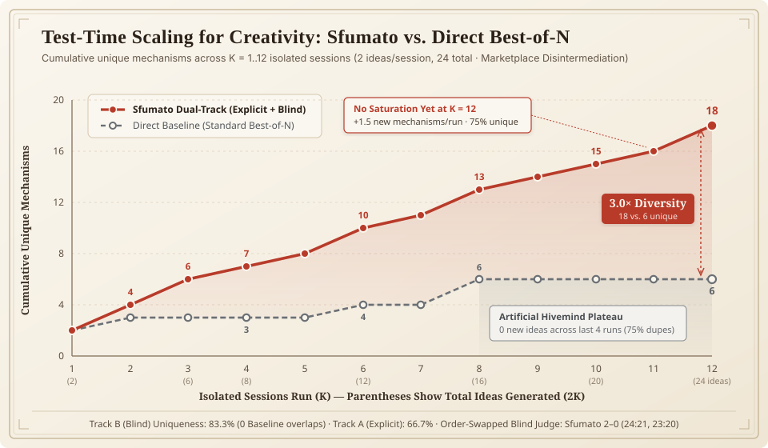
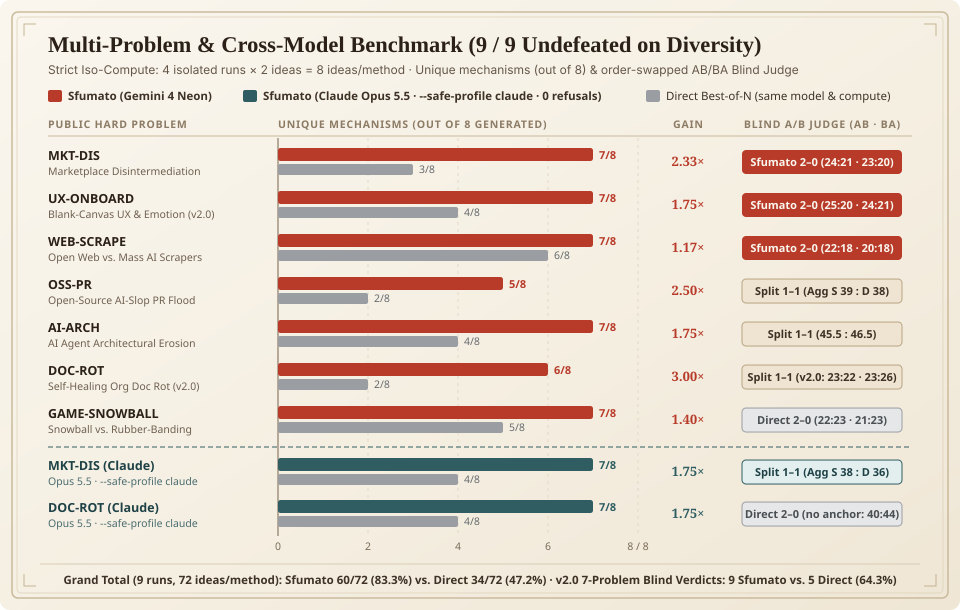
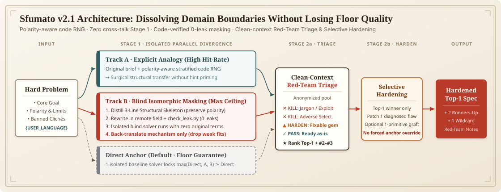

<div align="center">

<p align="center">
  
  &nbsp;&nbsp;
  
  &nbsp;&nbsp;
  
</p>

# 🎨 Sfumato

### *消融领域边界，打破「人工智能蜂群同质化」，释放创造力的测试时扩展（Test-Time Scaling）*

<p>
  <a href="./README.md">English</a> · <a href="./README.ko.md">한국어</a> · <a href="./README.ru.md">Русский</a> · <a href="./README.zh-CN.md"><strong>简体中文</strong></a>
</p>

<p>
  
  
  
  
</p>

> *“Sfumato”（意大利语：如烟消散，中文常译作「晕涂法」）是列奥纳多·达·芬奇消融生硬轮廓、让全新形态自然浮现的绘画技法。达·芬奇从不把自己困在单一学科里——他将解剖学、流体力学、要塞筑城术与光学原理彼此移植，催生出惊人的发明。*
>
> **Sfumato** 是一款超轻量级智能体技能（`/sfumato`、`/sfm`），让前沿大语言模型也做到同样的事——**无需外部 RAG、无需微调、零第三方依赖。**

</div>

---

## 🔥 核心痛点：为什么常规 LLM 总会撞上 *Artificial Hivemind* 之墙？

在写代码和严谨推理任务中，**干净且高度相关的上下文**就是王道。无关信息会分散注意力、拉低准确率。

**但在开放式头脑风暴中，情况恰恰相反。**

当你向 LLM 抛出一个开放难题——即便开启 12 个彼此完全隔离的新会话——模型仍会坍缩回那 3~6 个最安全、最教科书式的陈词滥调（*Artificial Hivemind*，NeurIPS）。强行调高 `temperature` 往往在产生真正概念跃迁之前就先破坏了逻辑连贯性；而多智能体辩论甚至会让结果*更糟*（*Diversity Collapse*，多样性坍缩）。

> **🧪 来自我们先导实验的「铁证」（`OSS-PR`）：**
> 在解决*「如何阻止开源仓库被 AI 生成的低质灌水 PR（AI-slop PR）淹没」*的隔离实验中，**三个彼此完全独立的会话**（`Direct Baseline 1`、`Direct Baseline 2`，甚至包括一个 `Explicit 热力学` 会话）**竟然各自独立发明了完全相同的示例包名：`pkg@pr-4821` / `pkg@patch-4821`。**
>
> 而在 Sfumato 的 **盲态同构掩码（Blind Isomorphic Masking）** 轨道中，**零个**会话触发 `4821` 或任何基线陈词滥调。

---

## 📈 创造力的测试时扩展（实测数据，`K = 1..12`）

我们在一个经典的硬核产品难题——*在不使用聊天监控、罚款或亏损补贴的前提下，阻止双边服务平台（家教、保洁、自由职业、装修等）买卖双方私下现金跳单*——上运行了 **12 次完全隔离的会话（每种方法共 24 个方案）**，并对底层因果机制进行了严格去重：

<p align="center">
  
</p>

| 指标（`K = 12` 隔离运行，各生成 24 个方案） | Direct Best-of-N | **Sfumato Dual-Track** | 差距 |
|---|---:|---:|---:|
| **发现的独立结构机制数量** | `6 / 24`（`25.0%`） | **`18 / 24`（`75.0%`）** | **3.0×** |
| **第 9–12 轮新增机制数（最后 8 个方案）** | `0` *（彻底平台期）* | **`+5` *（仍在上升）*** | **∞** |
| **Track B（盲态）唯一率 / 与基线重合数** | — | **`83.3%` / `0` 次重合** | 零陈词滥调引力 |
| **交叉换序盲评 A/B 裁判（`AB` 与 `BA`）** | `0–2` *（21:24, 20:23）* | **`2–0` 完胜 *（24:21, 23:20）*** | 消除位置偏置 |

> **核心结论：** 靠 **Direct Best-of-N** 盲目多抽几次根本没用——它在 `6` 种机制处就彻底锁死（75% 重复）。**Sfumato 打开了创造力的测试时扩展（Test-Time Creativity Scaling）：** 每增加一次尝试，都能探索到真正正交的新机制簇，不断推高**单点创意天花板（Top-1）**。

---

## 🌍 多难题与跨模型基准测试（多样性 `9 / 9` 全胜）

这套方法在交易平台博弈论之外是否同样有效——例如**情感化 UX 设计**、**开放网络反 AI 爬虫**、**软件架构治理**，以及在 **Claude Opus 5.5** 等其他前沿模型上？

我们在 **严格等算力（Iso-Compute）** 条件下（`4 次隔离运行 × 2 个方案 = 每法 8 个方案`，交叉换序 `AB`/`BA` 盲评裁判），测试了 **Gemini 4 Neon 上的 7 个公开难题**，并在 **Claude Opus 5.5** 上使用 `--safe-profile claude`（过滤 8 个敏感生物/CBRN/网络战/反间谍领域）进行了 **2 项跨模型复现**，**24 次隔离调用实现 0 次安全拒答**：

<p align="center">
  
</p>

| 公开难题 | 模型 | Direct 独立/8 | Sfumato 独立/8 | 多样性倍率 | 盲评 `AB · BA`（满分 30） | 最终裁定 |
|---|---|---:|---:|---:|---|---|
| **`MKT-DIS`** *（双边平台防跳单）* | Gemini 4 Neon | 3 / 8 | **7 / 8** | **2.33×** | **24:21 · 23:20** | **Sfumato 2–0 胜** |
| **`UX-ONBOARD`** *（空白画布恐惧 · 情感 UX，v2.0）* | Gemini 4 Neon | 4 / 8 | **7 / 8** | **1.75×** | **25:20 · 24:21** | **Sfumato 2–0 胜** |
| **`WEB-SCRAPE`** *（开放网络对抗大规模 AI 爬虫）* | Gemini 4 Neon | 6 / 8 | **7 / 8** | **1.17×** | **22:18 · 20:18** | **Sfumato 2–0 胜** |
| **`OSS-PR`** *（开源项目防 AI 灌水 PR）* | Gemini 4 Neon | 2 / 8 | **5 / 8** | **2.50×** | **21:17 · 18:21** | **平局 1–1** *（总分 +1）* |
| **`AI-ARCH`** *（AI 编程助手导致的架构侵蚀）* | Gemini 4 Neon | 4 / 8 | **7 / 8** | **1.75×** | **23:22.5 · 22.5:24** | **平局 1–1** |
| **`DOC-ROT`** *（组织文档腐烂自愈，v2.0）* | Gemini 4 Neon | 2 / 8 | **6 / 8** | **3.00×** | **23:22 · 23:26** | **平局 1–1** *（较 v1.2 +3 分）* |
| **`GAME-SNOWBALL`** *（滚雪球与生硬橡皮筋机制）* | Gemini 4 Neon | 5 / 8 | **7 / 8** | **1.40×** | 22:23 · 21:23 | Direct 2–0 *（诚实失利）* |
| **`MKT-DIS`** *（跨模型 · `--safe-profile claude`）* | **Claude Opus 5.5** | 4 / 8 | **7 / 8** | **1.75×** | 18:19 · **20:17** | **平局 1–1** *（总分 +2 · 0 拒答）* |
| **`DOC-ROT`** *（跨模型 · `--safe-profile claude`）* | **Claude Opus 5.5** | 4 / 8 | **7 / 8** | **1.75×** | 20:22 · 20:22 | Direct 2–0 *（无 Anchor · 0 拒答）* |

- **总计（9 轮实验，每法 72 个方案）：** **多样性 9 / 9 全胜**——独立机制数 **`60 / 72 (83.3%)`** 对比 Direct `34 / 72 (47.2%)`（**1.76×**）。
- **v2.0 7 大难题盲评战绩：** **9 Sfumato 对比 5 Direct（`64.3%`）**——**3 胜 3 平 1 负**（在跨领域方案晋级 Top-1 的全部 6 道题中实现 **0 败绩**）。
- **可复现原始日志：** 所有原始 JSON 记录与裁判打分依据均公开在 [`benchmarks/v2/`](./benchmarks/v2/)——可在本地运行 `python tools/summarize_benchmarks.py benchmarks/v2` 验证汇总结果。

> **⚖️ Sfumato 最擅长的场景——以及诚实的边界：**
> - **最闪耀的领域：** 开放式产品与商业战略、激励与机制设计、打破刻板印象的情感/行为 UX（`UX-ONBOARD` 2–0 完胜），以及需要突破行业定式的系统架构难题。
> - **诚实的局限（`GAME-SNOWBALL`）与 Pool v2.0 改进结果：** 在强耦合的实时物理/数值平衡系统中，如果抽样预算较小（`K=3`）且碰巧连续抽到制度治理类领域，可能输给强力 Direct 基线，强行嫁接不匹配的跨领域点子反而会拉低质量（`43 → 39`）。扩展至新增认知·材料·电网/水文大类的 **Domain Pool v2.0（`74 个领域 / 11 个大类`）** 后，`GAME-SNOWBALL` 已翻盘为 **`8/8` 独立机制 + 盲评 `2–0` 胜出（`46:39`，日志见 [`game_snowball_pool_v2_results.json`](./benchmarks/v2/ablations/game_snowball_pool_v2_results.json)）**；面对强工程/数值系统，仍建议使用 `deep` 模式（`Direct Anchor + K=6`）由锚点锁住下限（`≥ Direct`）。

---

## 🏛️ Sfumato v2.0 工作原理：*领域掩码权衡（Domain-Masking Trade-Off）*

大多数跨领域提示词研究只使用 **显式类比（Explicit Analogy）**（*“用生物学原理解决平台跳单”*）。由于原问题的行业词汇仍留在提示词里，LLM 依然会发生**局部同质化**，被拉回熟悉套路。

反之，**纯盲态重构（Blind Reframing）** 虽然能 100% 切断陈词滥调引力，但因为部分抽象解难以无损回译，平均命中率偏低。

**Sfumato v2.0 将双轨并行隔离发射，再把去除来源标签的候选方案送入干净上下文的红队分诊与选择性加固环节：**

<p align="center">
  
</p>

1. **分簇代码随机抽样 + 安全配置（`sample_domains.py`）：** 绝不让 LLM 自己“随机选个领域”（它总会反复挑*蚂蚁、爵士乐和国际象棋*）。Sfumato 使用纯 Python 标准库 `random` 从 **11 个互斥大类共 74 个高机制密度领域** 中分层抽取。传入 `--safe-profile claude` 可自动排除 8 个敏感生物/网络战/反间谍领域——保留 **66 个 Claude 安全领域（11 个大类各精确 6 个，零抽样偏置），Claude Opus 5.5 实测 0 拒答**。
2. **Track A — 显式类比 *（高命中率）*：** 原始问题简报 + 分配的远程领域 → 精准打击具体业务攻击面。
3. **Track B — 盲态同构掩码 *（最高上限 · v2.0 三行结构骨架）*：**
   - 先将原问题提炼为 **三行领域中立结构骨架**（*状态变量 · 激励极性 · 不可消除的权衡*），再改写进目标领域，并执行 **原始词汇零泄漏检查**。
   - 全新隔离的子智能体完全在远程学科内部求解——**从物理上切断原领域陈词滥调的引力。**
   - 仅回译因果机制与权衡取舍（果断丢弃牵强附会的硬套方案）。
4. **Direct Anchor *（`deep` 模式 · 下限保障）*：** 在匿名候选池中加入 1 路隔离的常规直出方案，确保 `max(Direct, Explicit, Blind) ≥ Direct`，在纯工程类问题上绝不劣于常规提问。
5. **Stage 2a/2b — 干净上下文红队分诊与选择性加固 *（v2.0）*：**
   - **Stage 2a：** 未受污染的新鲜评估者先砍掉表面术语堆砌，逐一排查 **逆向选择（Adverse Selection）**、**女巫/刷单套利（Wash-Trading）** 与可行性漏洞，并将可修复的潜力原石标为 `HARDEN` 而非一刀切淘汰。
   - **Stage 2b：** *仅* 针对最终 Top-1 胜出方案的单一最大落地短板做精修加固（当 `Direct Anchor` 堂堂正正获胜时严禁强行嫁接）。这一升级让 `DOC-ROT` 从 `0–2` 扳回 `1–1`（+3 分），并拿下 `UX-ONBOARD` `2–0` 完胜。

---

## ⚡ 效果对比展示：双边平台防跳单（`MKT-DIS`）

> **问题：** 自由职业者、家教、保洁和装修师傅在平台与客户初识后，为省下 10–20% 佣金转去微信/现金私下复购。*禁用陈词滥调：聊天关键词监控、罚款封号、普通担保/保险、亏损返现或 0 佣金。*

| 方法 | 实际产出方案 | 决定性差异 |
|---|---|---|
| **Direct Best-of-N**<br>*（12 轮，24 个方案）* | 24 个方案里有 18 次重复同样的 3 套路：*T+0 逆向托管*、*可转让客源账本*、*空档自动补位*。 | 务实稳健，但完全困在同一套金融科技/运营剧本里。 |
| **Sfumato · 冠军方案**<br>*（寄生生物学 · 有性生殖的双重代价）* | **🏆 嵌合式任务重组** *（盲评 2–0 胜出）* — 将复购佣金中的 5–7% 定向转为每 N 次服务触发一次的**独立第三方专家交叉验视槽位**（家教盲测诊断、装修热成像/水平复检、代码资深工程师异步交叉评审）。 | 1 对 1 现金私单*在物理上无法*复制独立第三方核验，直接瓦解合谋议价区间——**服务方一旦提议私下交易，反而沦为「逃避质量审计的柠檬信号」。** |
| **Sfumato · Track B 盲态**<br>*（监察专员与密码学吹哨机制）* | **零知识廉洁免责存证通道** — 锁定报价/交付物承诺并提供防报复的无举报证明，让企业/业委会/团队采购方获得**可过审的反回扣免责权**。 | 把跳单从“省 15% 费用”重构为“帮机构买家消除吃回扣与审计追责风险”。 |
| **Sfumato · Track B 盲态**<br>*（人类学 · 库拉圈）* | **库拉谱系溯源链** — 仅平台内履约可为交付物盖上可验证的工匠谱系印记（提升房屋转售溢价、VC/并购 IP 尽调背书或职业履历可信度）。 | 线下私单沦为“断代无名品”，损失下游第三方市场价值。 |
| **Sfumato · 红队拦截案例**<br>*（流体力学 · 文丘里喷射器）* | **文丘里负佣金产能虹吸** — 复购收取 *-3%*（买家付 90、卖家拿 93），由紧急 B2B 高溢价订单（160）触发的 ±24–48 小时调档看涨期权补贴。 | 惊艳的物理迁移——**而 Sfumato 的红队闸门瞬间抓出了「熟人刷单套利（90→93）」致命漏洞**，防止其误登榜首！ |

<details>
<summary><strong>📊 查看全部 18 种 Sfumato 独立机制 vs 6 种 Direct 机制（完整 K = 1..12 日志）</strong></summary>

<br/>

#### Direct Best-of-N（`K = 1..12`，24 个方案 → **6 种独立机制**，K=8 起彻底平台期）
1. **可转让客户账本与传承版税** *（12 轮中出现 6 次）*
2. **T+0 逆向托管 / 期限错配结算** *（6 次）*
3. **取消空档自动补位与热切换替补** *（6 次）*
4. **锚点大客户拉新分成权益** *（4 次）*
5. **易逝闲置产能实物抵扣佣金** *（1 次）*
6. **B2B 耗材集采价差与税务合规通道** *（3 次）*

#### Sfumato Dual-Track（`K = 1..12`，24 个方案 → **18 种独立机制**，K=12 仍在爬升）
| 轮次 | 轨道 · 远程领域 | 新发现的独立机制 | 累计 |
|---:|---|---|---:|
| 1 | Explicit · `fluid_microfluidics` | ① 文丘里负佣金调档期权虹吸 · ② 微流控多层层流分馏 | 2 |
| 2 | Blind · `maritime_trade_guilds` | ③ 多边 Giro 净额轧差账本 · ④ 仓单拼箱与第三方留置权隔离 | 4 |
| 3 | Explicit · `parasitology_coevolution` | ⑤ **嵌合式交叉重组（🏆 盲评 2–0 冠军）** · ⑥ 逆向托管代谢时差解耦 | 6 |
| 4 | Blind · `horology_escapement` | ⑦ 差动恒力机构（Remontoir）收入/产能平滑器 *（1 项因翻译损耗淘汰）* | 7 |
| 5 | Explicit · `disaster_triage` | ⑧ 动态再分诊需求蔓延隔离盾 *（1 项与层流重合）* | 8 |
| 6 | Blind · `container_port_logistics` | ⑨ 双循环零空驶回程拼链 · ⑩ 缓冲堆场甩挂异步解耦（Drop-and-Hook） | 10 |
| 7 | Explicit · `siege_fortification` | ⑪ 中央军械库按次工具授权与余料退库权 *（1 项与替补重合）* | 11 |
| 8 | Blind · `ombudsman_whistleblower` | ⑫ 零知识反回扣免责存证 · ⑬ 阈值匿名分包商预警托管 | 13 |
| 9 | Explicit · `architectural_wayfinding` | ⑭ 开放中庭实时施工日志展窗（CPTED 自然监视） *（1 项与回程重合）* | 14 |
| 10 | Blind · `electronic_warfare_pls` | ⑮ 全局无冲突多方排期复用 *（1 项因翻译损耗淘汰）* | 15 |
| 11 | Explicit · `mycorrhizal_plant_defense` | ⑯ 三级营养层外部保险/信贷机构预警启动信号 *（1 项重合）* | 16 |
| 12 | Blind · `gift_economy_reciprocity` | ⑰ 库拉谱系二手溢价溯源 · ⑱ 夸富宴/Hau 三方延迟互惠时间银行 | **18** |

</details>

---

## 🚀 安装与使用（4 个纯文本文件 · 零外部依赖）

Sfumato 运行所需的全部内容都在 [`skill/sfumato/`](./skill/sfumato/) 目录下——仅包含 **4 个可直接审阅的文件**：
- `SKILL.md` — 技能指令与执行流程
- `references/prompt_templates.md` — Explicit、Blind 与 Red-Team 提示词模板
- `resources/domain_pool.json` — 11 个大类共 74 个高机制密度领域池（Claude 安全配置 66 个，每类 6 个均衡分布）
- `scripts/sample_domains.py` — 仅使用 Python 标准库（`argparse`、`json`、`pathlib`、`random`、`sys`；零网络请求、零磁盘写入）

克隆仓库、审阅文件内容后，将 `skill/sfumato` 复制到对应智能体的全局技能目录即可：

```bash
git clone https://github.com/Excelsus4/sfumato.git && cd sfumato

# Claude Code（含自动启用 --safe-profile claude 的 /sfm 与 /sfm-max 快捷指令）
cp -r skill/sfumato ~/.claude/skills/sfumato
cp commands/*.md ~/.claude/commands/

# Antigravity (agy)
cp -r skill/sfumato ~/.gemini/config/skills/sfumato

# Codex CLI
cp -r skill/sfumato ~/.codex/skills/sfumato
```

<details>
<summary>可选本地复制辅助脚本（克隆后支持 <code>--dry-run</code> 预览）</summary>

```bash
# macOS / Linux
bash tools/install.sh --dry-run
bash tools/install.sh --target claude   # 或 agy | codex | all | auto
```

```powershell
# Windows PowerShell
.\tools\install.ps1 -DryRun
.\tools\install.ps1 -Target claude      # 或 agy | codex | all | auto
```

</details>

### 使用方式

```text
/sfm 为非对称三阵营 RTS 设计一种非显而易见的机制，解决滚雪球且避免生硬橡皮筋追赶
/sfumato deep 模式：如何在不设付费墙的情况下，抵御开源仓库里的 AI 低质灌水 PR？
```

| 模式 | 流水线 | 适用场景 |
|---|---|---|
| `dual-track` *（默认）* | `2 Explicit + 2 Blind` → Red-Team 筛选器 | 日常高上限创意发散 |
| `deep` | `1 Direct Anchor + 3 Explicit + 3 Blind` → Red-Team 筛选器 | 卡壳的战略/架构难题（锁定 `≥ Direct` 下限） |
| `fast` | `3 Explicit` → Red-Team 筛选器 | Token 预算紧凑时的快速实用方案 |
| `sweep` *（仅手动启用）* | `1 Direct Anchor + 11 个领域`（每大类各 1 个）→ Red-Team | 一轮扫遍全部 11 个知识大类 |
| `max`（`/sfm-max`，*仅手动启用*） | **全部 66（Claude）/ 74 个领域** → 两轮锦标赛 *（11 大类预选 → 12 强总决赛）* | 不惜 Token 的核心战略/机制穷举探索 *（运行前强制确认会话数）* |

---

## 📚 研究基础

Sfumato 直接建立在 2024–2026 年四条交汇的 LLM 创造力研究脉络之上：
- **Artificial Hivemind** — Jiang 等（*NeurIPS 最佳论文*）：揭示了大语言模型在开放式构思中的模型内与跨模型同质化现象。
- **Diversity Collapse in Multi-Agent LLM Systems** — 证明密集辩论与共识拓扑会压垮语义多样性，由此确立了 Sfumato 第一阶段严格**零串扰（zero-crosstalk）**并行设计。
- **Unlocking LLM Creativity in Science through Analogical Reasoning**（Shen 等，2026）与 **Assessing Cross-Domain Mapping in Humans and LLMs**（Liu 等，2026）— 验证了深层结构关系迁移优于表面比喻。
- **Sfumato 的独特贡献：** 将 *显式类比*（高命中率、局部同质化）与 *盲态同构掩码*（较低命中率、零陈词滥调引力、重尾变异）之间的 **领域掩码权衡（Domain-Masking Trade-Off）** 工程化，并结合 **Direct Anchor** 与 **干净上下文红队闸门** 形成闭环。

---

<div align="center">


*“凡心灵未与双手同行之处，便无艺术。” — 列奥纳多·达·芬奇*

<sub>本文档所引用的列奥纳多·达·芬奇画作均来自 Wikimedia Commons 公共领域。</sub>

</div>
